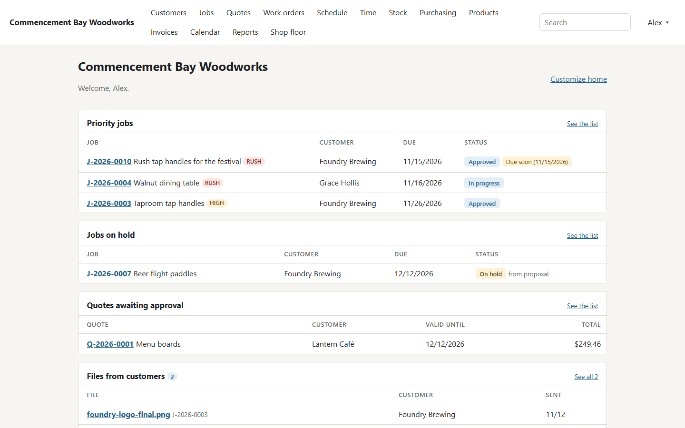
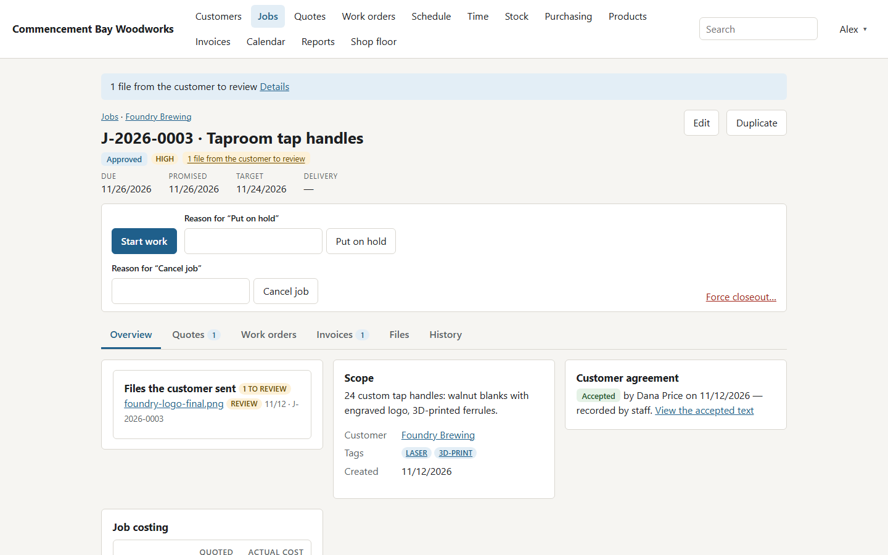
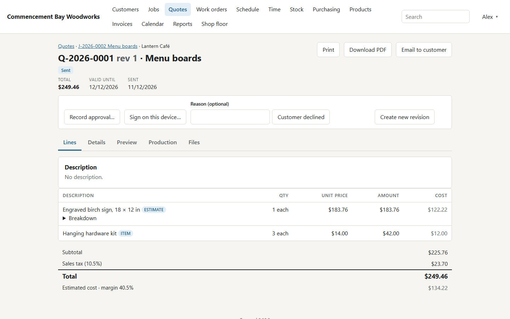
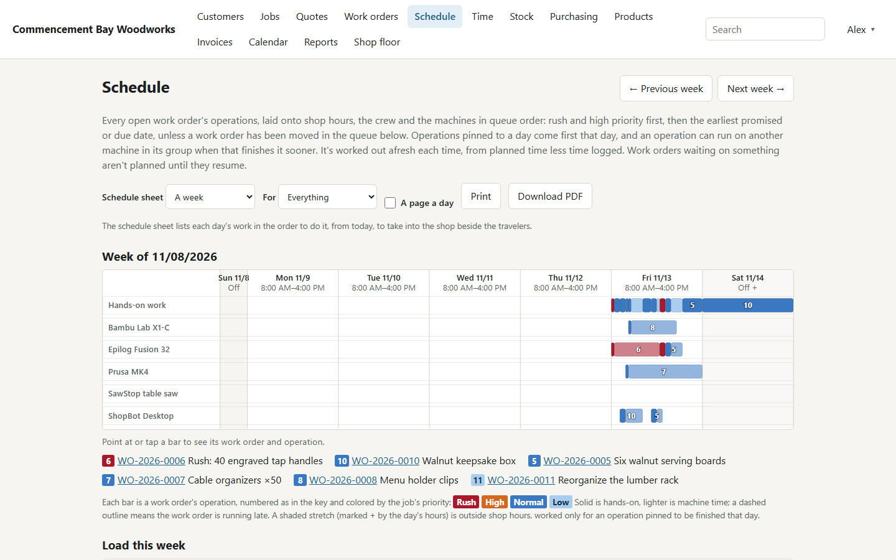
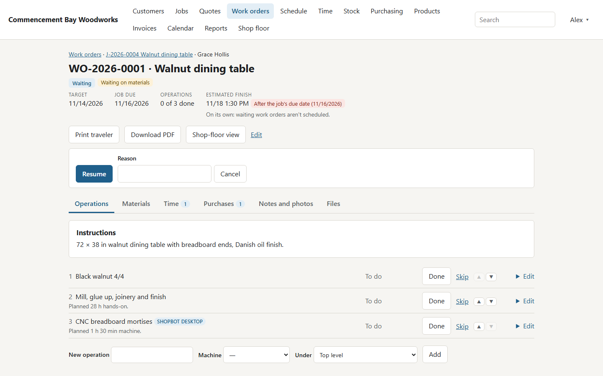
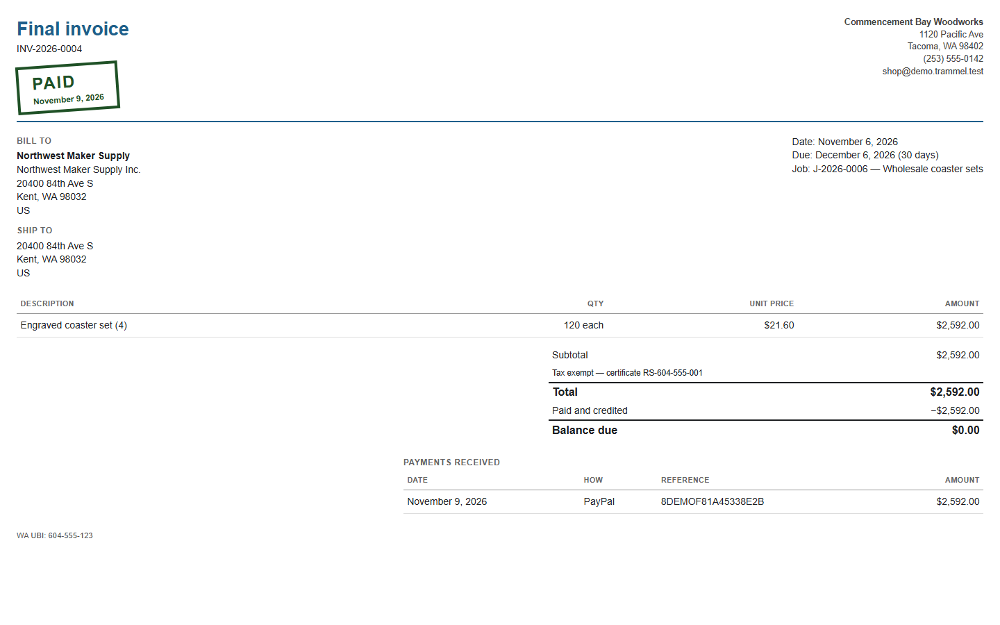
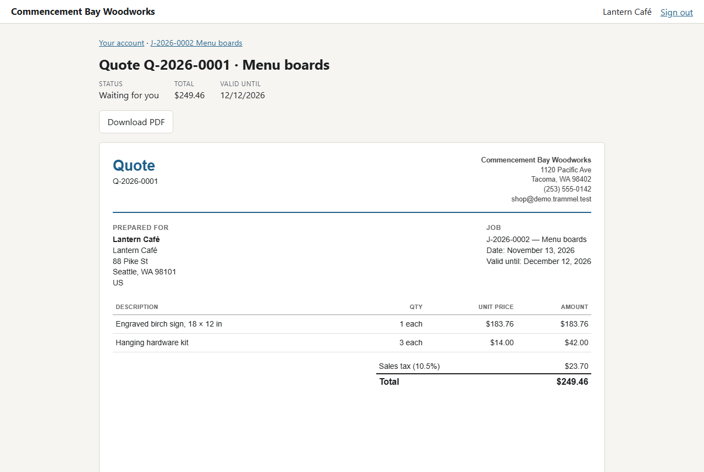
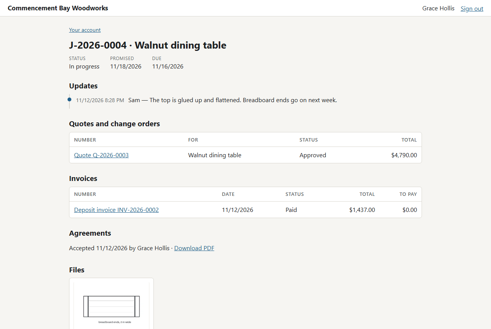
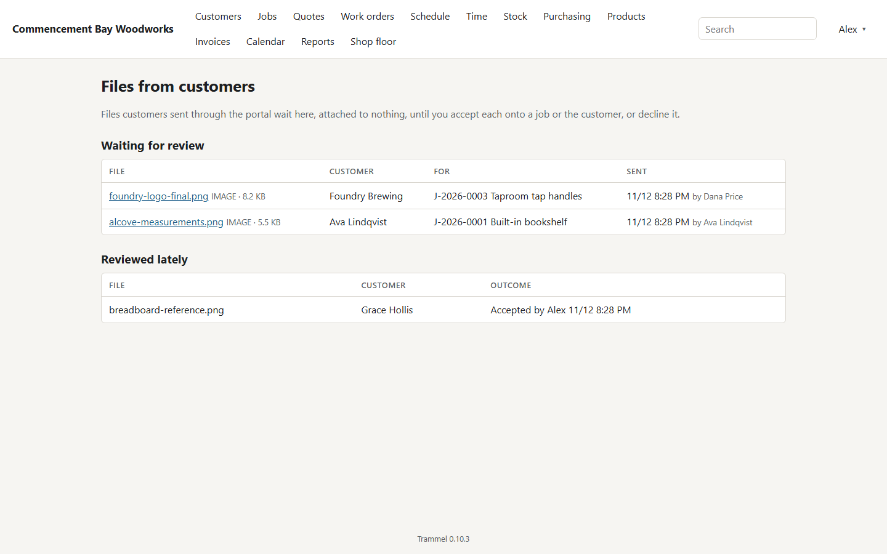
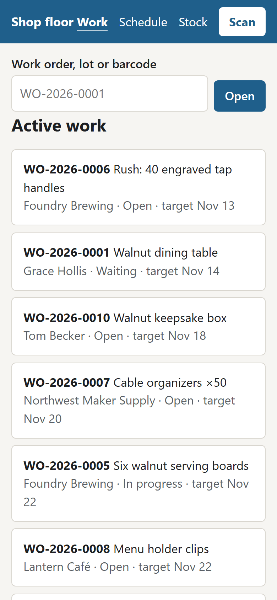

# Trammel

*Workshop and job management for small shops.*

Customers, quoting, jobs and work orders, time and material tracking, invoicing
and closeout for a 0–5 person job shop — woodworking, metal fabrication, 3D
printing, laser work. Self-hosted: the data stays on the shop's own hardware.

**Status:** Phases 1 to 3 are built; Phase 4 (breadth) is under way.

- **Customers, jobs and calendar** — contacts and addresses, tax exemptions, job
  lifecycle with holds, reopen and forced closeout, dates and a calendar.
- **Quotes** — line items, catalog products, and estimators for general work,
  3D printing, laser jobs and profile cutting (plasma, CNC); revisions,
  templates, approval with customer agreements, deposits, and a shipping or
  delivery charge. Lines can be offered as options or as alternatives (walnut
  or maple), picked by the customer when they approve. Each quote shows its
  production time and when the schedule could finish it, and a rush job's
  quotes carry a rush fee. Anything priced after
  a job is approved is a change order, with the same detail and optional
  amended terms and deposit.
- **Products** — a catalog of made, resold and service items, each with a
  routing (the steps it takes to make one, with machines and time) and a bill
  of materials, and a cost calculated from them unless set by hand.
- **Work orders** — operations with planned and logged time, products' routings
  as steps, planned and used materials, approved change orders added as
  operations, printable travelers with a QR code (one at a time or many at
  once), and a phone/tablet shop-floor app.
- **Schedule** — open work laid onto shop hours, the day's crew and each
  machine in priority order, as a week-by-week machine timeline with each
  machine's load, and a scheduled start and finish on every work order,
  flagged when it would miss its date. Work orders can be moved in the queue,
  operations pinned to a day, machines grouped to stand in for each other, and
  machines that run unattended (a printer overnight) planned around the clock.
  A printable schedule sheet (and PDF) sequences each day's work for the shop,
  beside the travelers, and the shop-floor app shows the day's schedule.
- **Files** — drawings, photos, DXF, LightBurn, STL/3MF and G-code on
  customers, jobs, quotes, work orders and products, with revisions and
  previews: DXF drawings, STL and 3MF models, and the thumbnails LightBurn and
  G-code files carry.
- **Machines, materials and vendors** — a machine rate calculator, a materials
  price list linked to vendors with product pages and files.
- **Stock and purchasing** — stock locations, lots and a ledger, units and
  barcodes per material, remnants kept and found by size, QR labels and one
  scanner for labels, travelers and barcodes, and a restock list. Purchase
  orders are placed, printed and received in part or whole at landed cost,
  with vendor returns, cost changes after delivery, and buying for a work
  order. Bills of materials are used from stock as the work is done.
- **Time** — timers and manual entries for people and machines, costed at each
  machine's calculated cost per hour (from the machine rate calculator).
- **Invoicing** — deposit, progress, final and direct-sale invoices, credit
  notes, recorded payments and write-offs. A paid invoice is stamped Paid (or
  Partly paid, with what's still due) and lists the payments received, and a
  payment receipt attaches the invoices it paid. Sales tax is looked up offline
  from manual rates, CSV files or Streamlined Sales Tax files (tested against
  Washington's), with tax exemption certificates kept on the customer.
- **Reports** — job profitability, sales, receivables aging, sales tax and
  gross receipts (B&O), time and machine use, stock, material use, purchasing
  and cost variances.
- **Customer portal** — off until you turn it on. Customers you give access
  sign in with an emailed code, or one you give them, to see their jobs,
  quotes, invoices, shared files and updates, approve or decline quotes,
  signing to accept the agreement, pay invoices online, and send files, which
  wait for staff to accept them. Customers can also sign on a shop tablet.
  Staff can view the portal as a customer sees it, read-only. One switch, or
  the `PORTAL_OFF` setting, turns the portal off without touching anything
  else.
- **Customer portal on Cloudflare** — optional: the same portal, approvals,
  files and payments included, served from a Cloudflare Worker that Trammel
  deploys and keeps in sync over Cloudflare's API, so the server never has to
  be reachable from the internet.
- **Online payments** — optional: customers pay an invoice's balance by card
  or bank through Stripe, or through PayPal (on a PayPal invoice numbered as in
  Trammel), from the portal or an invoice email. One way to pay is offered per
  invoice, so it can't be paid twice: the shop's primary provider, or one
  chosen for the customer or the invoice. Trammel makes and keeps each payment
  page and records what's paid, with no webhook to reach it.
- **Online orders** — Shopify, Etsy, eBay and WooCommerce orders, and ShipStation
  and Shippo orders from anywhere else, fetched by date come in once each, as
  paid sales at the store's prices and tax, with their customers; tax a
  marketplace pays itself is kept apart from tax you owe, and eBay's account
  deletion requests are wiped and reviewed. An order ShipStation or Shippo
  passes on from a connected store only adds its shipping details. Orders whose
  buyer the store withheld wait for a customer; one that has to be made
  becomes a job.
- **Running it** — users and roles, two-factor sign-in, a configurable home
  page, audit log, email notifications, the REST API, scheduled backups with
  off-site copies (a network folder or S3-compatible storage), restore and
  export, and an update check.

Not yet: the rest of Phase 4 (STEP previews and an interactive 3D viewer,
woodworking and metal fabrication estimators, and WebAuthn sign-in), then
importing and exporting customers, machines, materials and vendors,
user-defined reports, and in-app help.

## Screenshots

From the demo data (`manage.py seed_demo`). More in
[docs/screenshots](docs/screenshots).

| | |
| --- | --- |
|  |  |
| **Home**: what needs attention. | **A job**, with a file the customer sent to review. |
|  |  |
| **A quote**, priced with the laser estimator. | **The schedule**, by machine and priority. |
|  |  |
| **A work order**, waiting on materials. | **An invoice paid online** through PayPal. |
|  |  |
| **The customer portal**: approving a quote. | **The customer portal**: a job's updates and files. |
|  |  |
| **Files from customers**, waiting for review. | **The shop-floor app** on a phone. |

## Documentation

- [docs/INSTALL.md](docs/INSTALL.md) — install it with Docker.
- [docs/DEVELOPMENT.md](docs/DEVELOPMENT.md) — run it locally, run the tests,
  and how the pieces fit together.
- `artifacts/SPEC.md` — the product and technical specification (not version
  controlled). Requirement IDs such as `FR-JOB-4` are cited in code and tests.
